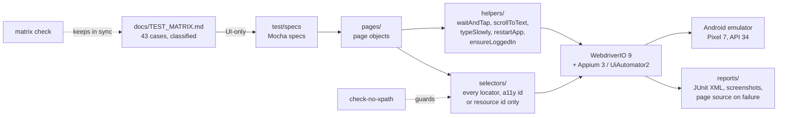
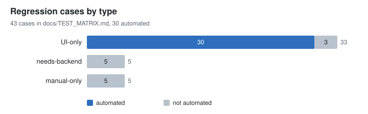
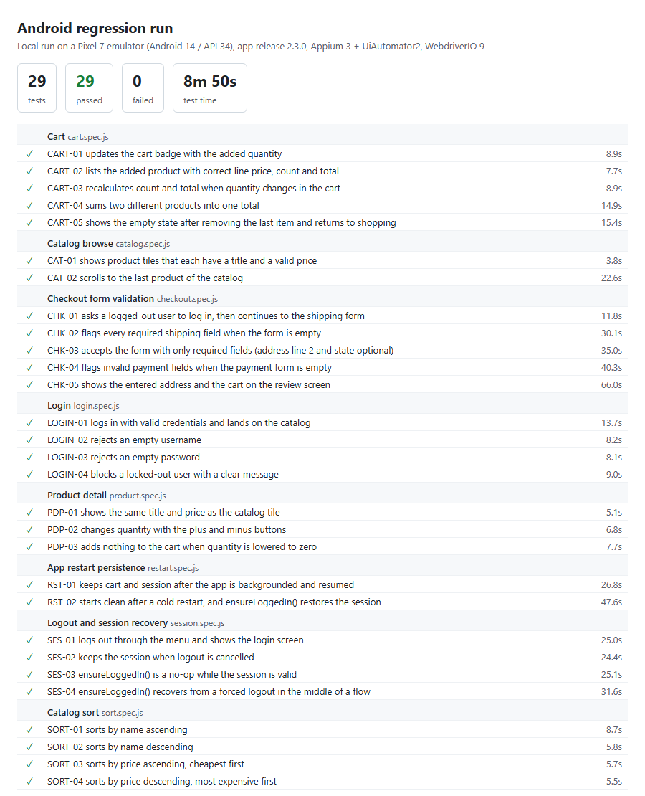
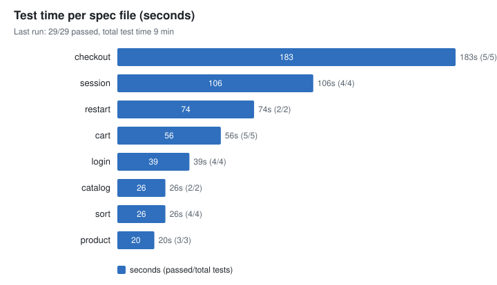

# Mobile regression suite (Appium + WebdriverIO)

[](https://github.com/GerasimoskiDesign/mobile-regression-suite-appium/actions/workflows/ci.yml)

An automated Android regression suite that turns a manual pre-release checklist into a repeatable run: 29 tests, page objects, one file for every locator, automatic re-login when a session drops, and a test matrix that shows what is automated, what is not, and why.

Rebuilt from scratch on synthetic data. The production version is proprietary.

## The problem

Before every release of a mobile app, about 60 regression cases were run by hand, on two environments. Repeating the same taps for every release is slow and easy to get subtly wrong, and the release has to wait for it. Some cases genuinely need a person (real payments, a code sent by SMS), but many only need someone to tap through screens and compare what they see against what they expect, which a machine does more consistently.

## What this does

The cases were classified first, then automated in order of payoff:

- **UI-only** cases (everything happens on the device) were automated first as a proof of concept.
- **needs-backend** cases (one-time codes, emails, push messages) stay manual until a test hook exists. The suite is built so they plug in later without restructuring.
- **manual-only** cases (real money, physical camera, visual judgement) stay manual on purpose.

This repository applies the same design to a public demo shop app (Sauce Labs "My Demo App" for Android).



Key pieces:

- **One home for locators.** `selectors/index.js` holds every locator; page objects never build selector strings. Only accessibility ids and resource ids are allowed, and `npm run check:selectors` fails the build if an XPath (or a string WebdriverIO would silently turn into XPath, such as `android.widget.Button`) appears anywhere in the suite.
- **Session resilience.** `ensureLoggedIn()` detects a lost session (login screen on display, or the menu offering "Log In") and logs back in. `SES-04` forces a logout in the middle of a checkout flow and proves the flow continues; `RST-02` does the same after a cold app restart.
- **Retries for the environment, not for bugs.** A failed spec file is re-run once in a fresh session (`specFileRetries`), which absorbs emulator and ADB hiccups. A real bug fails again and stays red. Every failure saves a screenshot and the page source next to the JUnit report.
- **An honest test matrix.** `docs/TEST_MATRIX.md` lists all 43 cases with type and status. A unit test checks that every automated row exists in the named spec, that every spec test has a row, and that the summary counts match the table.

## Results on synthetic data

Everything below comes from running this repository against the public demo app with made-up test data (demo accounts, a fake address, a test card number). No real users, orders or payments are involved.

**Coverage of the matrix** (from `docs/TEST_MATRIX.md`):

| Total cases | Automated | of which quarantined | Not automated | UI-only | needs-backend | manual-only |
| ----------- | --------- | -------------------- | ------------- | ------- | ------------- | ----------- |
| 43          | 30        | 1                    | 13            | 33      | 5             | 5           |



**Passing runs** of the default suite (29 tests in 8 spec files, the quarantined `PDP-04` excluded), app release 2.3.0:

| Where                                                    | Passed | Spec-file retries used | Test time   | Suite wall clock | Whole job   |
| -------------------------------------------------------- | ------ | ---------------------- | ----------- | ---------------- | ----------- |
| Local Pixel 7 emulator, Android 14 (API 34)              | 29/29  | 0                      | 8 min 50 s  | 10 min 21 s      | -           |
| GitHub Actions `e2e-android`, emulator API 34, first run | 29/29  | 0                      | 13 min 21 s | 15 min 46 s      | 20 min 49 s |

The CI emulator renders in software (no GPU), so every step is slower there; its wait limits are doubled (`TIMEOUT_FACTOR=2`) so slowness is not reported as a failure. "Whole job" includes installing Appium, downloading the app and creating the AVD (no cached snapshot on the first run). The CI run report is uploaded as the `e2e-android-reports` artifact.





**A real defect found along the way.** While building the product specs, the suite found that the demo app crashes when the tile in grid position 2, or any tile from position 5 on, is tapped (`NullPointerException` / `ArrayIndexOutOfBoundsException` in `ProductCatalogFragment`; reproduced on releases 2.2.0 and 2.3.0). It is recorded as `KNOWN-01`, the regular flows only open products in positions that work, and `PDP-04` is a quarantined test (`@known-defect`) that keeps failing until the app is fixed. `npm run test:known-defects` runs it on its own.

## Production context

> _Production context: TODO(Mario) — what the real version did and its outcomes, using only publicly shareable facts._

## Quickstart

You need Node 20+, Java 17, the Android SDK with an emulator (Pixel 7, API 34), and the GitHub CLI (`gh`, logged in) to download the demo app.

**Windows (PowerShell)**

```powershell
git clone https://github.com/GerasimoskiDesign/mobile-regression-suite-appium.git
cd mobile-regression-suite-appium
npm ci

# One-time: Appium server and Android driver
npm i -g appium
appium driver install uiautomator2

# Environment for Appium (adjust paths to your machine)
$env:JAVA_HOME = "C:\Program Files\Eclipse Adoptium\jdk-17-hotspot"
$env:ANDROID_HOME = "$env:LOCALAPPDATA\Android\Sdk"

# Start the emulator in a second window and wait until it has booted
& "$env:ANDROID_HOME\emulator\emulator.exe" -avd Pixel_7

npm run fetch-app        # downloads the pinned demo APK into apps/
npm run lint             # ESLint, Prettier, no-XPath check
npm run test:unit        # device-free unit tests
npm test                 # full suite on the emulator (WebdriverIO starts Appium)
npm run report           # reports/summary.md and reports/summary.html
```

**macOS / Linux**

```bash
git clone https://github.com/GerasimoskiDesign/mobile-regression-suite-appium.git
cd mobile-regression-suite-appium
npm ci
npm i -g appium
appium driver install uiautomator2
export ANDROID_HOME="$HOME/Library/Android/sdk"   # Linux: $HOME/Android/Sdk
"$ANDROID_HOME/emulator/emulator" -avd Pixel_7 &
npm run fetch-app
npm run lint
npm run test:unit
npm test
npm run report
```

Useful variations:

```bash
npm run test:suite -- login           # one suite: login, catalog, product, cart, checkout, session
npx wdio run config/wdio.conf.js --spec test/specs/cart.spec.js
npm run test:known-defects            # only the quarantined @known-defect tests
```

Settings such as an already running Appium server, a specific device or slower timeouts go in `.env` (copy `.env.example`).

## Project structure

```
mobile-regression-suite-appium/
├── .github/workflows/
│   ├── ci.yml                 lint, no-XPath check, matrix check, unit tests (every push)
│   └── e2e-android.yml        full suite on an Android emulator (manual trigger)
├── config/
│   ├── wdio.conf.js           runner, Appium service, retries, reporters, failure hooks
│   ├── capabilities.js        Android capabilities from environment variables
│   └── timeouts.js            all waits in one place, scaled by TIMEOUT_FACTOR
├── selectors/
│   ├── strategies.js          the only allowed locator builders
│   └── index.js               every locator in the suite
├── pages/                     page objects: Header, Menu, Login, Catalog, Product, Cart, Checkout
├── helpers/
│   ├── gestures.js            waitAndTap, scrollToText, typeSlowly, replaceText
│   ├── app.js                 restartApp, backgroundApp
│   ├── session.js             ensureLoggedIn, forceLogout
│   ├── parse.js               price / count parsing, sort checks, money maths in cents
│   └── artifacts.js           screenshot + page source on failure
├── data/                      demo accounts, fake address, test card, catalog facts
├── test/
│   ├── specs/                 8 spec files, 29 regular tests + 1 quarantined
│   └── unit/                  30 device-free tests (node:test)
├── scripts/
│   ├── fetch-app.js           downloads the pinned APK with gh
│   ├── check-no-xpath.js      fails the build on XPath locators
│   ├── matrix.js              keeps the TEST_MATRIX.md summary in sync
│   ├── junit-summary.js       JUnit XML -> markdown / HTML run summary
│   ├── charts.js              README charts
│   ├── run-unit-tests.js
│   └── run-known-defects.js
├── docs/
│   ├── TEST_MATRIX.md         all cases, types, reasons, known defects
│   └── img/                   charts and the run screenshot
└── apps/                      downloaded APK (git-ignored)
```

## Design decisions & trade-offs

- **Accessibility ids first, resource ids second, no XPath.** Accessibility ids are part of the app's public contract and also help screen-reader users; resource ids are stable across layout changes. XPath breaks whenever a layout is refactored and is the slowest strategy on UiAutomator2. A few rows (menu entries, product tiles) share one resource id, so those use a `UiSelector` anchored on the resource id and narrowed by text. That is still not XPath, and the unit tests enforce the allowed forms.
- **Clean state through a cold restart, not a reinstall.** The demo app keeps cart and login in memory, so terminating and relaunching it gives every test a clean start in a few seconds. Reinstalling would take close to a minute per test on CI. The trade-off: on an app that persists state on disk this would need `mobile: clearApp` instead.
- **Closing the menu by tapping beside it.** The Android back key closes the whole app on the catalog screen instead of closing the drawer, so `MenuPage.close()` taps the dimmed area to the right of the drawer. The point is computed from the drawer's bounds, not hard-coded.
- **Quarantine instead of deleting a failing test.** `KNOWN-01` is a real crash in the demo app. Deleting the test would hide it; leaving it in the main run would make every run red and train people to ignore red. It is tagged `@known-defect`, excluded from the default run, listed in the matrix, and runnable on its own.
- **Spec-file retries, not test retries.** A retry in a fresh session fixes environment problems (emulator lag, ADB disconnects). Retrying individual tests inside the same broken session rarely helps and hides real flakiness.
- **Versions.** The brief asked for Node 20, Appium 2 and the latest WebdriverIO. WebdriverIO 10 needs Node 22, so the suite stays on WebdriverIO 9 (latest 9.x) to keep Node 20. Appium 3 is used because `npm i -g appium` installs it and the current UiAutomator2 driver requires it; the client API is the same as Appium 2. Moving to WebdriverIO 10 and Node 22 is a version bump in `package.json` and the workflows.
- **Pinned app release.** `scripts/fetch-app.js` downloads release 2.3.0 by default, so an upstream release cannot change the app under test between two runs. The workflow can test another release through its `app_release` input.
- **Limitations.** Android only; one emulator profile; no parallel devices; sort tests check the tiles on screen rather than the whole list; the checkout stops at the review screen because placing an order belongs to the manual payment cases.
- **What I would do next.** Automate the two cheap backlog rows (`DEV-03` geo location via `setGeoLocation`, `DEV-04` drawing via pointer actions); add an iOS capability set reusing the same page objects; add a test-only OTP endpoint to unlock `LOGIN-05`; run the e2e workflow nightly on a schedule instead of only on demand.

## Tech stack

- JavaScript (ES modules), Node 20 in CI
- WebdriverIO 9 with Mocha, spec reporter and JUnit reporter
- Appium 3 with the UiAutomator2 driver
- Android emulator (Pixel 7 profile, API 34) via `reactivecircus/android-emulator-runner` in GitHub Actions
- ESLint, Prettier, `node:test` for the unit tests, `espree` for the no-XPath check
- GitHub CLI for downloading the app under test

## License

MIT, see [LICENSE](LICENSE).
